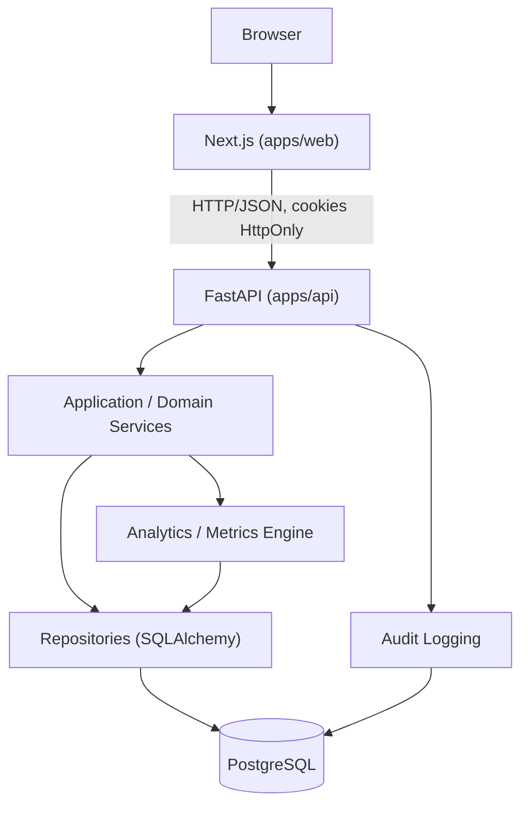

# Visão de Arquitetura

## Estilo arquitetural

Monólito modular (ver [ADR-0001](../adr/0001-monolito-modular.md)). Um único deployable de back-end (FastAPI) organizado em módulos de domínio com fronteiras claras, e um front-end Next.js separado consumindo a API via HTTP.

## Módulos (back-end)

| Módulo | Responsabilidade |
|---|---|
| `auth` | Cadastro, login, logout, recuperação/alteração de senha, emissão e validação de sessão |
| `users` | Perfil de usuário |
| `organizations` | Empresas/clientes (tenant) |
| `memberships` | Vínculo usuário↔organização com papel (RBAC) |
| `clients` | Alias conceitual de `organizations` no domínio de negócio (uma organização é o "cliente" da consultoria) |
| `products` | Produtos/serviços da empresa-cliente |
| `financials` | Dados financeiros por período |
| `marketing` | Canais e campanhas |
| `funnels` | Snapshots de funil por período |
| `campaigns` | Sub-domínio de `marketing`, campanhas específicas |
| `metrics` | Motor central de métricas (fórmulas, cálculo, versionamento de definição) |
| `analytics` | Comparação de períodos, agregações para dashboard |
| `experiments` | Experimentos/CRO |
| `integrations` | Contas e execuções de sincronização com fontes externas (estrutura futura) |
| `audit` | Trilha de auditoria |
| `reports` | Geração de relatório básico |
| `security` | Cross-cutting: RBAC, políticas de autorização, rate limiting |

Cada módulo segue a mesma estrutura interna: `router` (HTTP/FastAPI) → `service` (regra de negócio) → `repository` (acesso a dado via SQLAlchemy) → `models` (SQLAlchemy) / `schemas` (Pydantic). A camada `service` não depende de FastAPI; é testável isoladamente (RNF-016).

## Multi-tenancy

Estratégia: banco compartilhado, schema compartilhado, isolamento por `organization_id` em toda tabela pertencente a uma organização, aplicado obrigatoriamente na camada de repositório. Ver [ADR-0003](../adr/0003-estrategia-multi-tenancy.md) e o [threat model](../security/threat-model.md).

## Autenticação

Estratégia: token de acesso de curta duração + refresh token, ambos entregues como cookies `HttpOnly`, `Secure` (em produção) e `SameSite`. Ver [ADR-0004](../adr/0004-estrategia-autenticacao.md).

## Front-end

Next.js consome a API FastAPI via HTTP, nunca acessa o banco diretamente. Estado de sessão é gerenciado via cookie HttpOnly (não acessível a JavaScript do cliente), mitigando XSS de roubo de token.

## Por que não microserviços agora

Um único cliente inicial (a consultoria do usuário), volume de dados baixo no MVP, e o custo operacional de microserviços (deploy, observabilidade distribuída, contratos entre serviços) não se justifica. Reavaliar apenas se surgir necessidade real de escalar times ou domínios de forma independente (seção 28 do prompt mestre — evitar overengineering).
