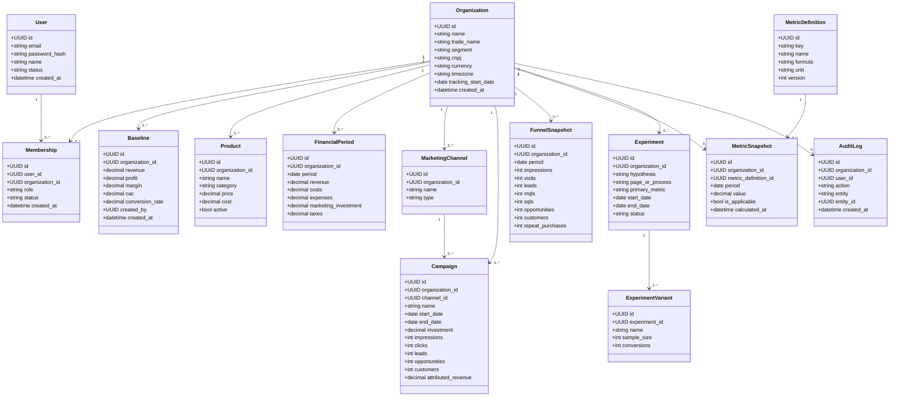

# Diagrama de Classes — Modelo de Domínio

> Diagrama simplificado para o MVP — não representa `integrations`, que ainda não tem modelo de dados detalhado (ver [out-of-scope.md](../../product/out-of-scope.md)).
