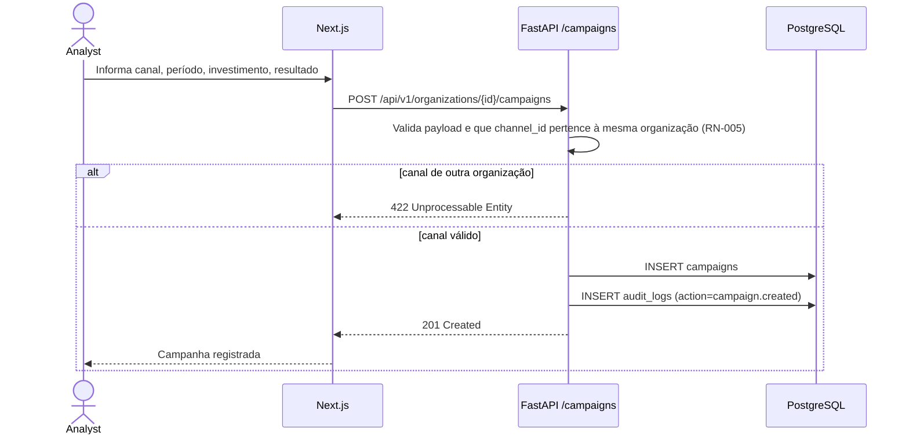

# Sequência — Lançamento Financeiro e Registro de Campanha

## Lançamento financeiro

```mermaid
sequenceDiagram
    actor A as Analyst
    participant W as Next.js
    participant API as FastAPI /financials
    participant DB as PostgreSQL

    A->>W: Informa receita, custos, despesas, investimento (período X)
    W->>API: POST /api/v1/organizations/{id}/financials (cookie)
    API->>API: Valida payload (Pydantic) e autorização (RNF-002)
    API->>DB: UPSERT financial_periods (organization_id, period)
    API->>DB: INSERT audit_logs (action=financial_period.upserted)
    DB-->>API: OK
    API-->>W: 200/201
    W-->>A: Financeiro do período salvo; motor de métricas pode recalcular
```

## Registro de campanha


