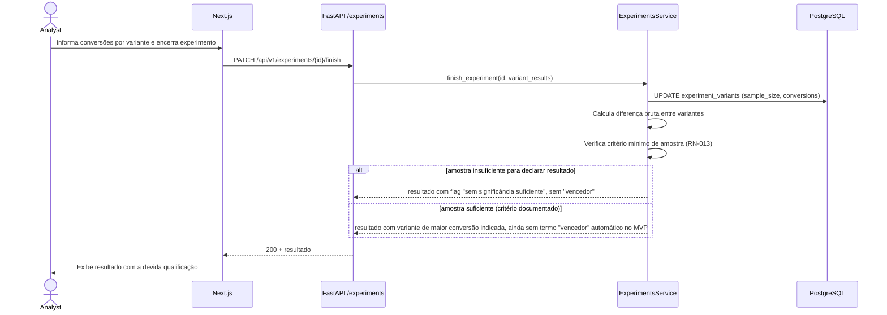
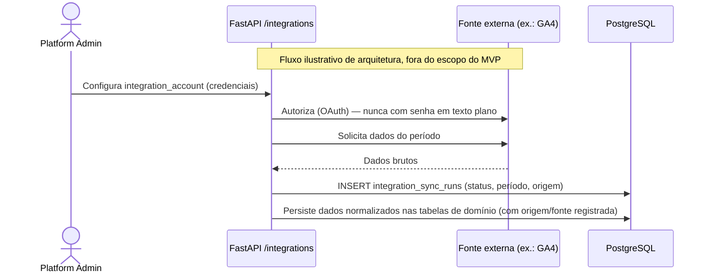

# Sequência — Execução de Experimento e Importação de Dados (futuro)

## Execução de experimento (registro de resultado)

## Importação de dados (arquitetura futura — Fase 17, não implementada no MVP)

