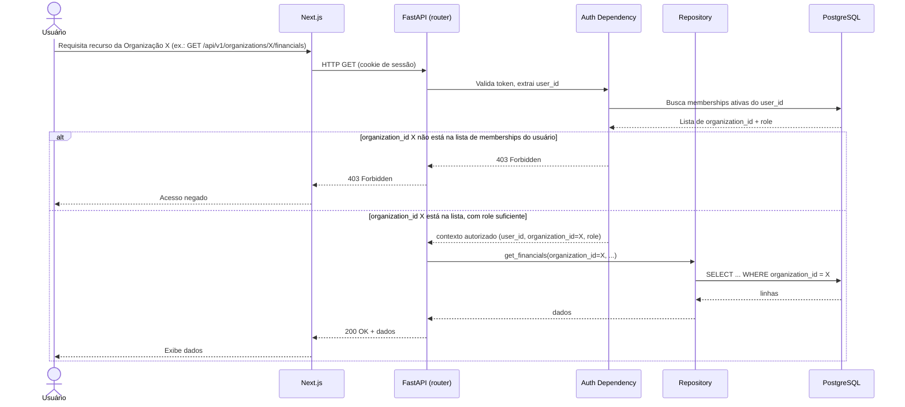

# Sequência — Autorização Multi-tenant (fluxo mais crítico do produto)

Este fluxo é validado por teste de integração automatizado (RNF-002, Fase 7) que garante explicitamente que o ramo `alt` (negação) ocorre quando um usuário tenta acessar organização à qual não pertence.
