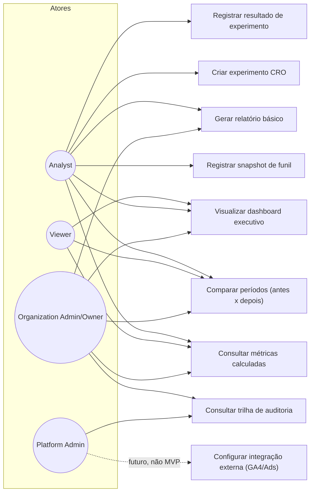

# Casos de Uso — Funil, Métricas, Experimentos, Dashboard, Relatórios, Auditoria, Integrações

Casos de uso relacionados a RF-020 a RF-027 — ver [functional-requirements.md](../../requirements/functional-requirements.md). UC23 é ilustrativo de arquitetura futura ([integrations](../../product/out-of-scope.md)), não implementado no MVP.
