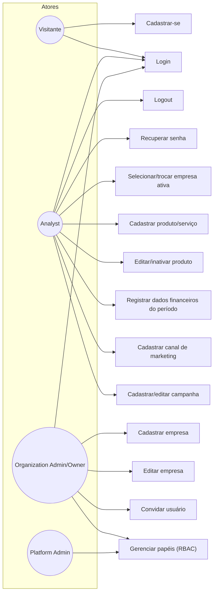

# Casos de Uso — Núcleo (Autenticação, Administração, Empresa, Usuários, Produtos, Financeiro, Campanhas)

> Notação: diagrama de casos de uso aproximado com Mermaid `flowchart` (Mermaid não tem notação UML de caso de uso nativa). Atores como nós de losango/retângulo arredondado, casos de uso como retângulos.

Casos de uso relacionados a RF-001 a RF-019 — ver [functional-requirements.md](../../requirements/functional-requirements.md).
