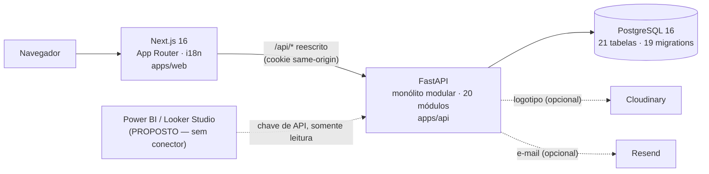
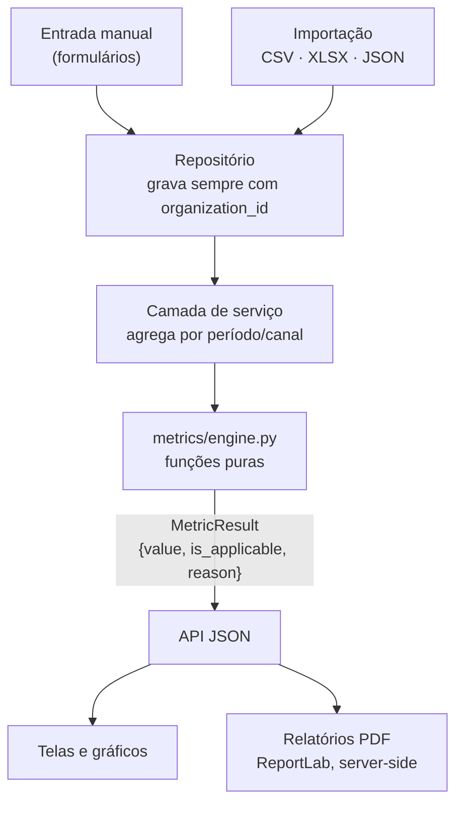
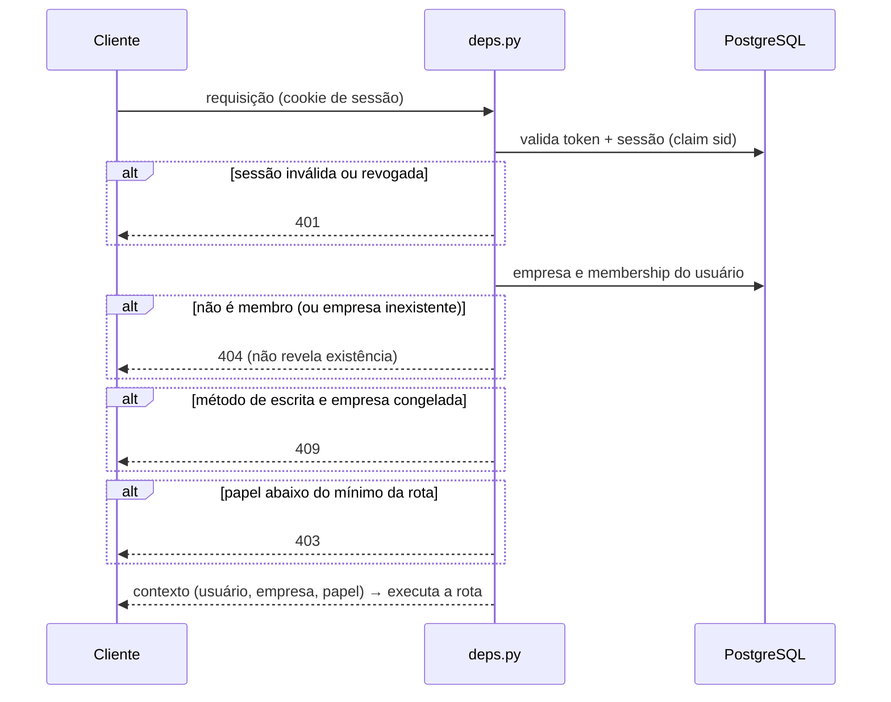
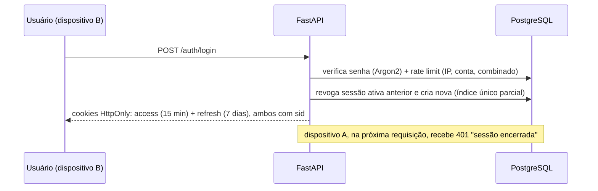
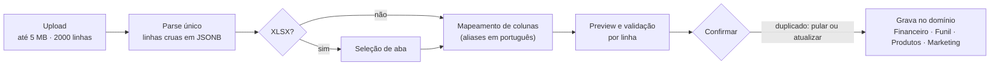
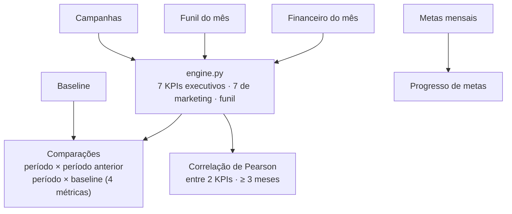
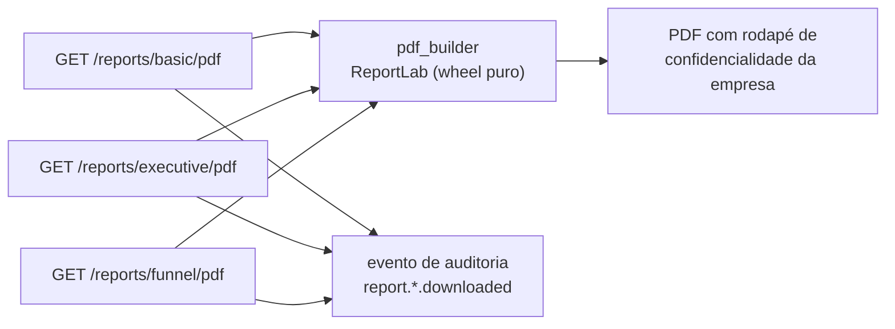

# Diagramas — Lucratix

> Somente componentes que **existem no código** (verificados em 2026-09-18). Onde algo é opcional ou não verificado em produção, o diagrama diz. Mermaid renderiza no GitHub e na maioria dos visualizadores de Markdown.
> Diagramas de sequência adicionais (autenticação/onboarding, entrada de dados, cálculo de métricas, autorização multi-tenant, experimentos) já existem em [`docs/diagrams/`](../diagrams/).

## 1. Arquitetura geral

Deploy: há Dockerfiles e `docker-compose.yml` para os três serviços; a documentação cita Vercel (web) e Railway (API). **Ambiente de produção não verificado.**

## 2. Fluxo de dados

Granularidade **mensal** (`period` = dia 1) para financeiro, funil e metas.

## 3. Multi-tenancy e autorização

Cadeia real de checagens de uma requisição a um recurso de empresa (`apps/api/app/core/deps.py`):

## 4. Autenticação e sessão única

## 5. Importação de dados

Síncrono, sem fila e sem armazenamento do arquivo original.

## 6. Analytics e comparações

## 7. Relatórios

