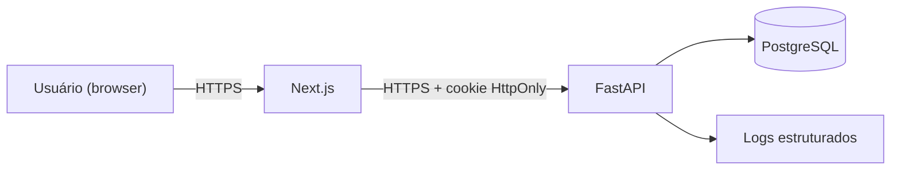

# Threat Model (STRIDE)

## Escopo

Fluxos críticos: autenticação, seleção/troca de organização, acesso a dado de organização, motor de métricas, auditoria. Ativo mais sensível: dados financeiros e de marketing por organização-cliente, isolados por tenant.

## Fluxo de dados (resumo)

Fronteiras de confiança: (1) browser do usuário — não confiável; (2) Next.js — confiável mas não deve manipular segredos além do necessário; (3) FastAPI — fronteira de autorização; (4) PostgreSQL — dado em repouso.

## Análise STRIDE

| Categoria | Ameaça concreta | Mitigação |
|---|---|---|
| **S**poofing | Atacante tenta se passar por outro usuário reutilizando/roubando token | Cookies `HttpOnly`/`Secure`/`SameSite` (ADR-0004); hash de senha moderno (RNF-003); rate limiting em login (RNF-005) |
| **T**ampering | Atacante altera `organization_id` em uma requisição para acessar dado de outra empresa (IDOR/BOLA) | Filtro de `organization_id` derivado da sessão, nunca de input não validado (RNF-002); teste de integração dedicado (Fase 7) |
| **R**epudiation | Usuário nega ter feito uma alteração de dado sensível (ex.: financeiro) | Trilha de auditoria append-only (RN-015) com usuário, ação, entidade, timestamp |
| **I**nformation Disclosure | Vazamento de dado entre organizações; enumeração de e-mail cadastrado; dado sensível em log | RNF-002 (isolamento); RN-012 (sem enumeração); RNF-010 (logs sem dado sensível) |
| **D**enial of Service | Força bruta em login; abuso de endpoint de cálculo de métrica | Rate limiting (RNF-005); nesta fase, sem proteção de DDoS de rede (fora do escopo do MVP, tratar na Fase 18) |
| **E**levation of Privilege | `ANALYST` tenta se autopromover a `ORGANIZATION_OWNER`; usuário sem membership acessa organização | RN-009 (hierarquia de papéis, só atribui igual ou inferior ao próprio); RN-008 (membership obrigatória) |

## Risco mais crítico

**Elevação de privilégio horizontal entre organizações (acesso cruzado de tenant)** é o risco de maior impacto do produto — ver [risks.md](../product/risks.md) e [ADR-0003](../adr/0003-estrategia-multi-tenancy.md). Mitigação primária: centralizar filtro de tenant na camada de repositório + suíte de teste de integração obrigatória antes de qualquer PR que toque em rota de dado de organização ser considerada concluída (Definition of Done, seção 24 do prompt mestre).

## Fora do escopo desta versão do threat model

- Ameaças de infraestrutura de nuvem (não há deploy definido ainda).
- Ameaças de supply chain de dependências — cobertas operacionalmente por `pip-audit` e `npm audit` no CI, não modeladas aqui em detalhe.

Este documento deve ser revisado a cada fase que introduza um novo fluxo de dado sensível (ex.: integrações externas na Fase 17).
